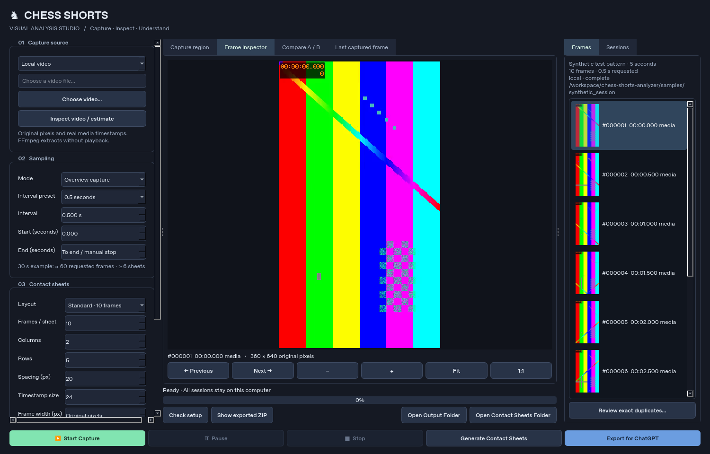

# Chess Shorts · Visual Analysis Studio

A local-first Windows 11 desktop app for capturing and inspecting video frames, generating timestamped contact sheets, and exporting visual research for ChatGPT. No API keys, subscriptions, chess engine, or video editor.



## Install on Windows 11

1. Install **64-bit Python 3.12+** from [python.org](https://www.python.org/downloads/), including the Python launcher.
2. Download and extract this repository, then double-click **install_windows.bat**. Wait for “Setup complete”. It installs the app into its own folder and does not change PowerShell settings.
3. Double-click **launch_windows.bat** to open the app.
4. To import local videos, install **FFmpeg and ffprobe** and make both available on PATH. One option is `winget install --id Gyan.FFmpeg --exact` in Command Prompt. Reopen the app after installation. You can use **Check setup** in the app to see whether they are available.

For optional YouTube URL automation, open Command Prompt in the app folder and run `.venv\Scripts\python.exe -m playwright install chromium`. Brave window capture and local import do not require Chromium. If your computer is managed by an organization, its security rules may restrict installers or downloads; follow your administrator’s guidance.

## Everyday Brave workflow

1. Open a Short in Brave, Chrome, or Edge. Keep the browser restored and the video visible.
2. In the app, select **Browser window**, click **Refresh browser windows**, and select your browser window.
3. Click **Refresh capture preview** and drag a rectangle around just the video. Check the preview before starting.
4. Choose an interval (default **0.5 seconds**). Click **Start Capture**. During the three-second countdown, switch to Brave and play the video.
5. Click **Stop** when finished. Completed frames are preserved and contact sheets are generated automatically. Pause/Resume pauses collection, not browser playback.
6. Click **Export for ChatGPT**. Upload the PNG sheets individually using **Open Contact Sheets Folder**, or use the ZIP if your analysis workflow supports it.

Native window capture currently uses PrintWindow, with a foreground-only fallback for compatible surfaces. It does not promise minimized, obscured, protected, or every GPU window. Check the preview; see [limitations](docs/limitations.md). Actual elapsed capture times are labeled separately from media timestamps.

## Local videos and detailed animation capture

Choose **Local video**, select MP4/WebM/MOV/MKV, choose the interval, then Start. FFmpeg samples without real-time playback and preserves image resolution. It supports variable frame rates and records actual presentation timestamps. Each requested timestamp selects the first available source frame at/after it; duplicate selections are omitted.

For detailed capture choose **Detailed animation capture**, set a start/end (for example 10–12 seconds), and an interval such as 0.1. The end is exclusive. If a session is open, the new detailed session is saved inside its `details/` folder and is separately reopenable. Otherwise it creates a standalone session.

## Inspect, organize, and export

- **Frames** shows asynchronously generated thumbnails. Use Previous/Next or arrow keys, mouse-wheel zoom, Fit, or 1:1 in the inspector.
- **Compare A / B** lets you pin a frame as A and select another as B. Difference shows absolute RGB difference at 2× contrast; equal dimensions are required.
- **Review exact duplicates** scans on request. Check individual duplicates to exclude them from future sheets; originals are never deleted. Regenerate sheets afterward.
- **Contact sheets** offers 10, 4, or 1 frame presets and custom rows/columns, spacing, background, labels, PNG/JPEG, and output frame width. Zero width preserves original pixels. Oversized sheets split automatically. PNG is recommended for detailed analysis.
- **Sessions** reopens, renames, deletes after confirmation, regenerates, and re-exports local sessions. Double-click a session or open a folder containing `metadata.json`. Settings persist between launches.
- **YouTube URL** normalizes Shorts/watch/share URLs and attempts Playwright-controlled seeking in a separate Chromium profile. It does not use your Brave login or bypass restrictions. If automation fails, select Browser window and capture the video normally.
- **Export for ChatGPT** creates `contact_sheets.zip` in the session folder with sheets, JSON metadata, CSV timestamp index, and analysis instructions. Individual originals are optional. Nothing is uploaded by the app.

Default library: `Documents/ChessShortsStudio` (change it under Local storage).

```text
ChessShort_YYYY-MM-DD_HHMMSS_unique/
  frames/frame_000001.png
  contact_sheets/sheet_001.png
  details/                         # nested detailed sessions
  metadata.json
  contact_sheets.zip               # after Export for ChatGPT
```

Metadata includes source/title when known, UTC capture date, method, requested interval, actual media or elapsed timestamps, dimensions, sampling policy, sheet configuration, and interruptions/errors. Unknown fields stay null. A live window capture does not know the video's URL or playback timestamp.

## Development and tests

```powershell
python -m venv .venv
.\.venv\Scripts\python.exe -m pip install -e .
.\.venv\Scripts\python.exe -m unittest discover -s tests -v
```

On Linux/macOS use `.venv/bin/python`; local extraction, export, and Qt UI work there, but native window capture requires Windows. For headless UI tests set `QT_QPA_PLATFORM=offscreen`. Tests use `unittest` and generate their own synthetic footage with FFmpeg; they never need private or copyrighted clips.

For real local-video browser integration, install Chromium and set `RUN_BROWSER_TESTS=1` before running tests. `TEST_CHROMIUM_EXECUTABLE` may point the test harness to a supported system Chromium. This test uses a loopback HTTP server with byte-range support and does not contact YouTube.

Generate fresh sample footage, contact sheets, metadata, and a ZIP:

```powershell
.\.venv\Scripts\python.exe scripts/generate_samples.py
```

See [samples](samples/README.md), [validation](docs/VALIDATION.md), and [architecture](docs/architecture.md).

## Windows executable

Run `scripts/build_windows.ps1` on Windows after installation. Distribute the entire `dist/ChessShortsStudio` directory; the entry point is `ChessShortsStudio.exe`. FFmpeg remains an external prerequisite, and optional Playwright Chromium is installed in the user's normal browser cache. There is no signed installer yet.

The Windows GitHub Actions workflow runs core, browser, and offscreen desktop tests and builds a downloadable `ChessShortsStudio-windows` artifact. This task has not executed that workflow or produced a Windows executable on Linux. Native Brave acceptance testing remains required. Review [third-party licenses](docs/THIRD_PARTY.md) before distributing a bundle.

## First-run checks and capture helpers

- **Check setup** reports FFmpeg/ffprobe availability and whether optional Chromium is listed in Playwright's browser cache. Native window capture is Windows-only. Packaged builds refer you to the browser installation instructions instead of trying to launch a Python CLI.
- **Inspect video / estimate** reads the selected local video's duration and dimensions. Requested frame count, minimum sheet count, and approximate uncompressed image size update when you change the interval, range, or frames per sheet. These are estimates: VFR sampling, PNG/JPEG compression, layout splitting, and sheet spacing affect actual results. Before inspecting, a clearly labeled 30-second example is shown.
- **Last captured frame** displays a reduced preview of the latest saved image while capture runs (updated at most twice per second). It is a visual check, not a real-time playback monitor.
- Browser capture requires a fresh preview and an explicitly drawn crop. Changing the selected window or fallback mode clears the crop to prevent using a region from a different source. A delayed preview from an older selection is discarded.
- **Show exported ZIP** reveals the ZIP in Windows Explorer after export, or opens its containing folder on other platforms. It also works when reopening a session with an existing export.
